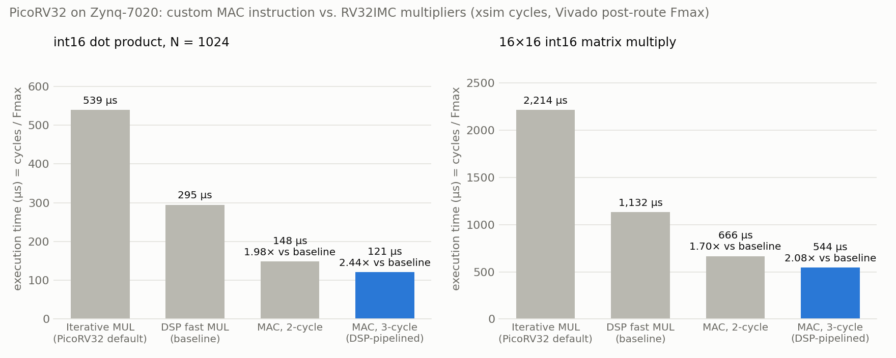

# Custom Multiply-Accumulate Instruction for PicoRV32

A multiply-accumulate (MAC) coprocessor for the open-source
[PicoRV32](https://github.com/YosysHQ/picorv32) RISC-V core, attached through its
PCPI coprocessor interface. It adds four custom instructions, including a packed
2×int16 MAC. The project covers RTL, verification, compiler support (`.insn`),
benchmark firmware and Vivado implementation on a Zynq-7020 (xc7z020clg400-1).



## Results

All cycle counts come from full-RTL simulation (Vivado xsim 2025.2) of the core
running the benchmark firmware. Fmax and resource figures come from Vivado 2025.2
out-of-context place-and-route on xc7z020clg400-1.

### Hardware cost (post-route)

| Configuration | LUT | FF | DSP48 | Fmax (MHz) |
|---|---:|---:|---:|---:|
| RV32IC, no multiplier | 1250 | 612 | 0 | 149.1 |
| RV32IMC, iterative MUL (PicoRV32 default) | 1535 | 891 | 0 | 144.5 |
| **RV32IMC, DSP fast MUL (baseline)** | **1388** | **712** | **4** | **146.2** |
| + MAC, 1-cycle | 1496 | 800 | 9 | 123.0 |
| + MAC, 2-cycle | 1493 | 854 | 9 | 117.8 |
| **+ MAC, 3-cycle (DSP-pipelined, final)** | **1488** | **875** | **9** | **149.0** |

The final MAC adds **+100 LUTs (+7.2%)**, +163 FFs and +5 DSP48s over the baseline,
with **no Fmax loss**: its critical path is back inside the PicoRV32 core
(`decoded_rs1`), not in the MAC unit. Each Fmax is the best of three runs with
4, 5 and 6 ns clock targets, computed as `1000 / (period − WNS)`. Across those
targets the baseline's Fmax varied from 137 to 146 MHz, so differences of a few
MHz are within tool noise.

### Performance (cycles, RV32IMC + DSP fast MUL baseline)

| Kernel | Baseline (C) | MAC, 3-cycle | Cycle speedup | Wall-clock speedup |
|---|---:|---:|---:|---:|
| int16 dot product, N = 1024 | 43,060 | 18,005 | 2.39× | 2.44× |
| 16×16 int16 matrix multiply | 165,537 | 81,073 | 2.04× | 2.08× |

The baseline column is the plain-C kernel **in the same binary** as the MAC
kernel, so code layout is identical apart from the kernel itself. The C kernels
don't use the MAC unit, so these cycle counts equal what the baseline core takes.
Built as a separate baseline firmware image, the C matmul takes 180,639 cycles
(2.23×) because of instruction alignment (see Findings), so 2.04× is the
conservative figure. Wall-clock time is cycles divided by each configuration's
own Fmax. For the int16 dot product, against PicoRV32's default iterative
multiplier the speedup is 4.3× in cycles (77,876 → 18,005). Against a core with
no M extension it is 38.5×.

Full data: [`results/bench.md`](results/bench.md), [`results/ppa.md`](results/ppa.md),
plus the JSON files next to them.

## Design

### Instructions

R-type, opcode `custom-0` (`0x0B`), `funct3 = 0`:

| funct7 | Mnemonic | Operation |
|---|---|---|
| 0 | `mac rd, rs1, rs2` | acc ← acc + rs1·rs2, rd ← acc |
| 1 | `macrst rd, rs1, rs2` | acc ← rs1·rs2, rd ← acc |
| 2 | `macrd rd` | rd ← acc |
| 3 | `mac16x2 rd, rs1, rs2` | acc ← acc + rs1[15:0]·rs2[15:0] + rs1[31:16]·rs2[31:16] (signed) |

PCPI passes only `rs1`/`rs2` to a coprocessor and never the old `rd` value, so the
accumulator is state inside the unit. It is 32 bits wide and wraps exactly like
C `int32_t` arithmetic, so results are bit-identical to a plain C loop.

### Pipelining

`pcpi_mac` has a `PIPE` parameter (latency `PIPE + 1` cycles):

- **PIPE = 0 / 1:** the full 32×32 multiply (a three-DSP48 cascade) sits in a single
  cycle. That becomes the critical path and limits the core to 118–123 MHz.
- **PIPE = 2:** adds a register stage directly after the multipliers, which Vivado
  absorbs into the DSP48 MREG/PREG pipeline. The packed-16 sum moves to the
  next stage. This costs one extra cycle per MAC instruction but restores
  baseline Fmax. It is the fastest variant in wall-clock time (see the chart).

### Compiler support

No toolchain changes are needed. [`sw/mac.h`](sw/mac.h) wraps each instruction in
`asm volatile` using the assembler's `.insn` directive:

```c
static inline void mac_acc16x2(uint32_t a, uint32_t b)
{
	__asm__ volatile (".insn r 0x0B, 0, 3, x0, %0, %1" :: "r"(a), "r"(b));
}
```

The resulting inner loop of the int16 dot product is
`lw, lw, mac16x2, addi, addi, bne`, which covers two elements per iteration.

## Findings

1. **Instruction count, not multiply latency, limits PicoRV32.** PicoRV32 is not
   pipelined and takes about 4–6 cycles per instruction. A scalar `mac` that
   fuses `mul` + `add` saves only one instruction per element. With alignment
   effects removed (finding 2), it gives just **1.11×** (39,986 → 35,894 cycles,
   exactly 4 cycles saved per element). The packed `mac16x2` halves both loads and
   loop iterations, which is where the 2.2–2.4× comes from.
2. **Compressed-instruction alignment matters.** With RVC enabled, a 32-bit
   instruction at a 2-byte-aligned address costs PicoRV32 an extra memory fetch. In the
   scalar `dot32_mac` loop, 4 of 6 instructions ended up at such addresses, which
   made it *slower* than the C loop (42,044 vs 39,989 cycles). This was confirmed
   by re-running both on RV32IM without compression (`nc_*` columns in
   `results/bench.md`).
3. **A benchmark pitfall.** GCC removed a timed call to `dot32_c` because it had
   already been called with the same arguments to compute the reference result
   (`cycles=6`). The kernels use `__attribute__((noipa))` to prevent this.

## Verification

- **Unit test** ([`sim/tb_pcpi_mac.v`](sim/tb_pcpi_mac.v)): drives PCPI exactly as
  PicoRV32 does, with directed, corner-case and 20,000 random operations. It
  checks results, latency and the accumulator against a reference model, and
  confirms foreign encodings are ignored. 20,265 checks pass for each of
  PIPE = 0, 1 and 2. A mutation test (high-half product removed from `mac16x2`)
  is caught with 9,964 failures.
- **System test:** each kernel's result is checked by the firmware against the
  plain-C reference and, independently, by `scripts/run_bench.py` against a
  Python model of the same data. All 8 configurations pass.

## Reproduce

Requires Vivado 2025.2 (xsim plus implementation) and the RISC-V GCC bundled with
Vitis. Set `VIVADO_SETTINGS` and `TOOLCHAIN` if your install paths differ.

```sh
git clone https://github.com/YosysHQ/picorv32 third_party/picorv32   # tested at ef203c2
python3 scripts/run_bench.py     # build firmware, simulate all configs -> results/bench.*
python3 scripts/run_vivado.py    # implement all configs (JOBS=6 parallel) -> results/ppa.*
python3 scripts/make_plots.py    # -> results/exec_time.png
```

## Layout

```
rtl/pcpi_mac.v          MAC coprocessor (decode, DSP pipeline, accumulator)
rtl/core_top.v          PicoRV32 + optional MAC; simulation and synthesis top
sim/tb_pcpi_mac.v       self-checking unit testbench
sim/tb_soc.v            128 KiB RAM + console/exit MMIO system testbench
sw/                     start.S, linker script, mac.h intrinsics, bench.c
scripts/                simulation, Vivado and plotting drivers
results/                measured data (JSON + Markdown) and chart
```

## Scope and limitations

- Results are from simulation and Vivado implementation. They were not run on
  physical hardware.
- Out-of-context implementation: memory-bus ports are not tied to device pins,
  so Fmax reflects the core's internal register-to-register paths.
- The test memory responds in one cycle. Slower memory would shrink the relative
  benefit, because loads take a larger share of each loop.
- "M" in the firmware builds is Zmmul (multiply only). The cores are built
  without PicoRV32's divider.

PicoRV32 is © Claire Xenia Wolf, ISC license.
